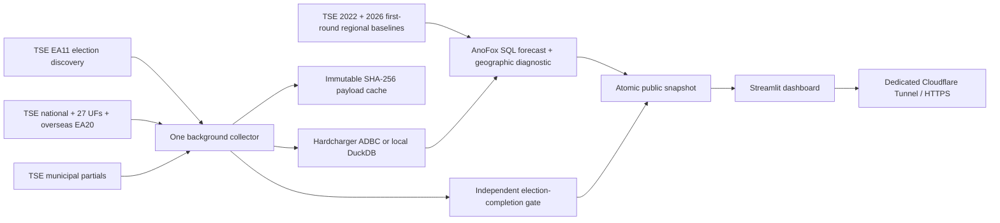

# Brasil 2026 — independent election observatory

**Live dashboard:** https://eleicoes2026.computadorpira.com  
**Public machine-readable state:** https://eleicoes2026.computadorpira.com/api/state  
**Repository:** https://github.com/gustavoleo/eleicao-forecast-2026

Fonte: TSE — Dados Abertos (resultados.tse.jus.br)  
**Projeção estatística, não é resultado oficial.**

This dashboard follows the Brazilian presidential election, automatically discovering the applicable round. It polls the national file every 15 seconds and each of 27 UFs plus overseas (`zz`) every 60 seconds. Model snapshots and browser refreshes occur every 60 seconds. One background collector serves all visitors. Closing a browser does not stop the deployed collector. The requested `streamlit-autorefresh` package is installed and selectable with `AUTOREFRESH_MODE=component`; it timed out through the public proxy, so the deployed fallback uses Streamlit's native 60-second fragment timer (`AUTOREFRESH_MODE=native`).

The deployed free fallback uses this Windows host's existing Podman WSL2 machine, a persistent named volume, and an isolated Cloudflare Tunnel. **The host and Podman must remain running and connected to the internet.** This is not independently hosted on Streamlit Cloud. Streamlit Cloud was inspected and required sign-in and acceptance of terms. No account or paid service was purchased. Render and Community Cloud deployment instructions are below.

## What “elected” means

Monte Carlo cannot establish mathematical certainty. A model probability, including 5,000 wins in 5,000 draws, never declares somebody elected.

The independent completion gate uses a recent, validated, **official national presidential EA20** and one of:

1. Exactly one candidate marked `e="s"`, together with `md="e"` (TSE's mathematically elected signal) or `tf="s"` (final totalization), and no `esae="s"` (no winner assigned).
2. A conservative arithmetic proof: in round two the leader's counted votes exceed the runner-up's votes plus every potentially remaining vote. In round one, twice the leader's votes exceed all counted valid votes plus that upper bound. Ties do not pass.

The upper bound includes electors in unreported, uncounted and uninstalled sections. Pending judicial/uncounted vote categories disable the independent bound. A mathematical result is explicitly conditional on the current published counts and their remaining-vote bound; later recounts, source corrections and legal decisions are outside that proof. The collector continues checking after a call so corrections remain visible.

**`md="s"` means a runoff is defined; it does not mean someone is elected.** Section completion alone is also insufficient. TSE documents this distinction in [EA20](https://www.tse.jus.br/eleicoes/eleicoes-2026-content/arquivos/divulgacao-de-resultados/tse-ea20-arquivo-de-resultado-unificado).

The UI suppresses confirmation if collection is older than 120 seconds, if an upstream error is active, or if a nonfinal TSE generation is older than five minutes. It separately displays the source generation timestamp, fetch time, and collector heartbeat. Old snapshots remain visible with warnings.

## Architecture



`raw_turbo` and `votes_parcial` append changed payloads only. `votes_projected` and `simulations_meta` retain every model snapshot, seed and input hash. `historical_2022` caches official historical aggregates. The public reader never opens the live DuckDB writer. Historical CSV download selects only the presidential member via HTTP Range, checks its ZIP CRC, records SHA-256 hashes and stores catalog provenance. It avoids downloading the entire approximately 643 MB archive.

## Preferred AnoFox model

The primary engine is the signed DuckDB community extension `anofox_forecast` (verified Linux build `v2026.10.22` on DuckDB 2.0). It is installed into the Docker image; telemetry is disabled. The Windows AMD64 2.0 community artifact returned 404 during verification, so use the supplied Linux/Podman runtime for the native extension. No unsigned loading or signature bypass is enabled.

The model consumes deduplicated official partial-count snapshots, not previously generated forecasts. Historical 2022 municipal and UF results provide geographic priors. Finalized 2026 first-round results replace those priors for the same territory as they arrive. Candidate totals are renormalized among the current eligible candidates; this is a baseline, not an assumption that all eliminated-candidate votes transfer to a particular person. Same-person matching is required unless the explicit operator proxy mapping is used.

When enough observations exist, the model subtracts the historical log-ratio expected for the regions that had reported at each historical snapshot, using only regional files generated by that time. Municipalities replace a UF only after their complete candidate totals reconcile. This guards against reporting-order bias and look-ahead leakage. National historical shares weighted by electorate provide the final-count anchor. Inconsistent historical regional coverage uses an explicitly recorded constant baseline.

`Naive`, `AutoETS`, `AutoARIMA`, and `Theta` are compared on an early chronological holdout. Models within 10% of the best MAE form an inverse-error ensemble. A separate later block calibrates an absolute-error radius; the last block tests error and coverage. Publication requires error within 10% of the naive baseline and at least 80% observed holdout coverage. The target horizon cannot exceed four times the tested horizon. These are operating guardrails, not evidence of externally calibrated election probabilities.

Training requires at least 12 distinct advancing source counts and 20 one-percentage-point grid positions. The grid carries the most recent earlier observation forward; it never interpolates from a future held-out count. Corrections that decrease completion restart the monotonic training segment. Final-share scenarios use paired empirical log-ratio residuals, square-root horizon scaling, and a 0.02 log-ratio noise floor. Both latter choices remain explicit heuristics requiring electoral calibration. Already counted votes are fixed after every scenario transformation. The national winner gate is independent of every model.

When the source is stale, observations are insufficient, or validation fails, the dashboard suppresses headline projections and victory frequencies. The geographic calculation remains available only as a clearly labeled diagnostic. The ordinary display shows official votes, not an invented replacement forecast.

## Geographic diagnostic and limits

- Above 5% of sections in a UF, the remaining share follows that UF's partial valid-vote share. Otherwise, it uses mapped 2022 UF shares plus the vote-weighted national swing from UFs above 5%.
- Current counted **national** votes are fixed. Remaining volumes use UF electorate coverage and observed valid votes per counted elector; low-count UFs use an explicitly documented 75% valid-vote/eligible-elector assumption. Section percentages are not assumed to be vote percentages.
- Cross-election identities are not silently matched. The live deployment explicitly uses `HISTORICAL_CANDIDATE_MAP={"13":"13","22":"22"}` as a **party/ballot-number proxy**. The 2022 candidate behind number 22 is a different person. The UI labels this assumption. An empty mapping only allows exact full-name matches; missing complete historical correspondence uses a national-share fallback, listed in model assumptions.
- 5,000 Dirichlet draws vary the remaining votes only. Concentration is 20 below 30% counted, 100 from 30% through 80%, and 500 above 80%. These are **requested heuristics, not empirically calibrated probability guarantees**. The 90% intervals are conditional on this model and exclude some geographic/reporting-order/turnout errors.
- The baseline is the current national valid-vote share. Geographic weighting can legitimately produce a different leader. All shares, intervals and simulation seeds are downloadable.
- First-round runoff pair probabilities are joint probabilities of no outright majority and that pair finishing first/second; conditional probabilities are also returned. In round two these and first-round victory probabilities are explicitly not applicable.
- All 5,757 EA12 municipal/overseas localities are scheduled behind primary BR/UF traffic. Complete municipal groups replace a UF only after electorate, section, candidate and pending-vote totals reconcile. Partial/inconsistent groups retain the UF model. The 2022 municipal archive supplies 74,763 candidate rows across 5,751 historical localities; new localities fall back to UF priors. Individual binary ballot files are not decoded. The application supports only the presidential contest.
- The poller does not certify TSE's signatures or electoral legal validity. It consumes the official HTTPS JSON source and retains provenance/hashes.

## Run locally

Python **3.12** is the tested runtime. The exact working package versions are pinned.

```powershell
git clone https://github.com/gustavoleo/eleicao-forecast-2026.git
cd eleicao-forecast-2026
uv venv --python 3.12 .venv
uv pip install --python .venv/Scripts/python.exe -r requirements-dev.txt
Copy-Item .env.example .env
# Set TSE_CONTACT_EMAIL to your real contact email in .env.
.venv/Scripts/python.exe -m src.service
```

Open `http://localhost:8501`; public state is `http://localhost:8080/api/state`. To run a bounded collection: `.venv/Scripts/python.exe -m src.ingest --duration 320`. Do not run two collectors against the same DuckDB file.

## Existing Windows Podman deployment

Use **native `podman.exe`**, connection `podman-machine-default-root`. Never recreate/reset the machine or alter `F:\VMs\WSL\podman-machine-default\ext4.vhdx`.

```powershell
podman.exe --connection podman-machine-default-root ps --filter name=eleicoes2026
podman.exe --connection podman-machine-default-root logs --tail 30 eleicoes2026-dashboard
podman.exe --connection podman-machine-default-root restart eleicoes2026-dashboard
podman.exe --connection podman-machine-default-root restart eleicoes2026-tunnel
Invoke-RestMethod https://eleicoes2026.computadorpira.com/health
```

Resources: `eleicoes2026-dashboard`, `eleicoes2026-tunnel`, `eleicoes2026-net`, named volume `eleicoes2026-data`, and Podman secret `eleicoes2026-tunnel-token`. Only the public dashboard and public JSON/health routes are exposed. Local ports bind to `127.0.0.1:18501` and `127.0.0.1:18502`. No other workloads or firewall policies are changed. A fresh local-only installation can use `scripts/start-podman.ps1` or `podman-compose up -d`; the compose file does not include the account-specific tunnel secret.

Staged update: build a new image with `podman.exe ... build --format docker -t localhost/eleicoes2026:next .`; stop this dashboard only with `--time 60`, back up the database and any adjacent `.wal` file while stopped, rename its stopped container to a dated rollback name, and start the new image with the same named volume/network/env/port options from `scripts/start-podman.ps1`. Keep the old image/container until the public page and `/api/state` verify. Use `scripts/backup_stopped_database.py` in a disposable container with `eleicoes2026-data:/source:ro` and a writable backup bind mount: `python /scripts/backup_stopped_database.py /source /backups/<new-directory>`. It copies the database plus any WAL, verifies hashes, opens and checkpoints only the copied database, and records table counts. A database-only file copied without its active WAL is not a complete latest-state backup. Never delete the named volume. Restart policy handles process failures while Podman is running; it does not power on this host or automatically start a stopped WSL machine.

## Hardcharger

Set `HARDCHARGER_URI`, `HARDCHARGER_USER` and `HARDCHARGER_PASSWORD` in the untracked `.env`, then recreate only the app container using the staged-update procedure (a plain restart does not refresh container environment). `HardchargerSession` bulk ingest uses ADBC; parameterized reads use the Hardcharger ADBC DB-API connection. At startup, absent or unreachable Hardcharger selects local DuckDB and logs the active backend. Existing local data is not automatically migrated to a new server. The deployed fallback is verified; an actual remote Hardcharger server was not supplied, so remote end-to-end storage remains unverified.

## Streamlit Community Cloud deployment

1. Sign in at https://share.streamlit.io and complete any required terms/authorization yourself.
2. Create a public app from `gustavoleo/eleicao-forecast-2026`, branch `main`, entrypoint `src/dashboard.py`; select Python 3.12.
3. Add root-level secrets `TSE_CONTACT_EMAIL="your@email"` and `RUN_EMBEDDED_INGESTOR="1"`; optionally add Hardcharger settings and `HISTORICAL_CANDIDATE_MAP` as a JSON string.
4. Deploy and verify charts, source time and data refresh. This mode starts one process-wide cached collector, but Community Cloud sleep/restarts and ephemeral disk do **not** guarantee uninterrupted collection or retention. The existing Podman deployment is the continuous mode.

## Render / Hugging Face alternatives

Render: sign in at https://dashboard.render.com, choose **New → Blueprint**, connect the repository, select `render.yaml`, set the contact email, and deploy. The Docker service listens on 8501. Free Render instances may sleep and have ephemeral storage; persistence requires external storage or a paid disk (not authorized/purchased here).

Hugging Face: create a **Docker** Space, select port **8501**, copy the repository's Dockerfile/source/requirements, and add the contact email as a Space secret. Streamlit is run inside the Docker SDK. Free Spaces can sleep and have ephemeral disk. No Hugging Face token was available in this environment. These fallback instructions are provided; the working public URL is Cloudflare/Podman.

## Verification

```powershell
postman simulation run postman/simulations/tse.sim.yaml --port 4900 --output ndjson
# In another terminal:
$env:POSTMAN_SIM_URL='http://127.0.0.1:4900/tse'
.venv/Scripts/python.exe -m pytest -q
postman spec lint postman/specs/tse.yaml --issueType=syntax
postman collection lint postman/collections/TSE-Contract
postman collection run postman/collections/TSE-Contract
.venv/Scripts/python.exe scripts/verify_rate.py data/requests.ndjson
```

The mock embeds real TSE fixtures. Owner mock lookup was unavailable without Postman login; Orbit returned unrelated APIs, so the official TSE specification and directly fetched JSON defined the integration. Mocked failure tests exercise the actual HTTP client, including HTML 403/429/500, Retry-After, circuit-breaker suppression, recovery, and conditional 304. Mock success does not certify upstream availability. The updated local Postman collection run reports four requests and four assertions, zero failures (`evidence/postman-municipal.txt`). `evidence/pytest.txt`, `evidence/postman-collection.txt`, `evidence/rate-compliance.json`, and `evidence/deploy-state.json` record distinct evidence.

Latest municipal deployment rate check: **314.55 seconds, 1,836 requests, 117 HTTP 304 responses, peak 11 completed responses in a sliding second, mean 5.837 req/s** (`evidence/rate-municipal.json`). Request starts are spaced by the configured 10 req/s limiter; completion clustering may produce 11 response records within one second. This collector stayed below 90 req/s; unrelated programs on the same public IP are outside this measurement. The earlier slower five-minute run and its heartbeat excerpt remain as historical evidence.

## Compliance and safety

The live integration follows [TSE's technical documentation](https://www.tse.jus.br/eleicoes/informacoes-tecnicas-sobre-a-divulgacao-de-resultados). EA11 discovery uses `/oficial/comum/config/ele-c.json`; the example `/ele2026/config/ea11.json` returned 404 and is not repeatedly probed. EA20 URLs use discovered election IDs and padded cargo/election fields. The [2022 data catalog](https://dadosabertos.tse.jus.br/dataset/resultados-2022) is the historical source.

Every TSE request identifies the contact via `EleicaoForecast/1.0 (+email)`. The default global scheduler is 2 req/s and capped at 10 req/s; the live municipal deployment uses 10 req/s, below the requested 90 limit. ETags and Last-Modified avoid unchanged downloads; SHA-256 deduplicates when the server still sends a body. A hash alone cannot tell whether remote bytes changed before a request. Changed raw files are retained on disk and in the database.

Errors use exponential backoff from five seconds, capped at 300 seconds plus applicable server Retry-After. HTTP 403 additionally opens a **600-second origin circuit breaker**, following TSE's documented ten-minute block; this deliberately overrides the prompt's generic 300-second cap to avoid extending an IP block. 429/5xx also defer the whole origin. Missing files back off at least five minutes. No aggressive retry loops or fabricated substitute live data.

Secrets live only in `.env`, Podman secrets, or deployment secret stores. `.env`, `data/`, `secrets/` and raw runtime logs are gitignored. Only public TSE fixtures and selected operational evidence are committed. The original reusable request is preserved in `PROMPT.md` and `prompts/PROMPT.md`.

## Verified deployment status

The current deployment includes model v3, the real signed AnoFox extension, municipal ingestion, first-round priors, and the mobile arithmetic-only map. `evidence/deploy-mobile-anofox.json` records the public state at 19:13 BRT on 25 October: source generated 19:12:36, 1.690743% counted, no upstream errors, 1,344 of 5,757 municipal locations collected, and no secured UF or national winner. These are historical verification figures; consult the live URL for current counts.

At early count, the primary forecast was correctly withheld until its rolling holdouts passed. By 26 October, 240 advancing official observations and 99 grid points were available; the AnoFox forecast had passed its chronological selection, calibration and final holdout checks. The primary simulation used 5,000 scenarios. The public card shows the lower bound, center and upper bound of its 90% share interval. These diagnostics do not establish guaranteed forecasting accuracy and never determine the mathematical election gate.

`evidence/pytest-anofox-linux.txt` records 61 passing core tests, including the native extension. Six HTTP integration tests pass separately in `evidence/pytest-http-latest.txt`. The persistent database was backed up before each staged deployment. Restart restored 745 municipal results and 774 first-round units with their original source/check times, then resumed collection. Older deployment/test evidence is retained with its original date and scope.

Municipal refinement is implemented. All localities are scheduled, but a UF only uses the finer model after complete, fresh municipal data reconciles with its parent totals. Binary section-level files are not decoded. The independent national gate is now satisfied for candidate 13 (Lula) on the current published TSE counts. The live official EA20 payload also carries TSE mathematical-definition flag `md="e"`. At the verified snapshot, the second-round arithmetic was 64,111,352 > 59,749,523 + 305,566; direct TSE candidate totals matched the published dashboard byte-for-byte by candidate and vote count. The result is mathematically secured under the published remaining-vote bound while TSE final totalization (`tf="s"`) and final candidate election status are still pending. Collection continues to detect corrected files and keep the call current. See `evidence/current-mathematical-call.json` for URL, SHA-256, timestamps, candidate totals, freshness, and the independent gate.

## Mobile map and first-round comparison

The presidential-only mobile layout uses the supplied dark/red/blue reference: compact official scorecard, Brazil state map, and Map / Forecast / Results views. Gray means no fresh conservative arithmetic result. A state receives a candidate color only if the local lead exceeds the upper bound of remaining votes, with complete bounds and no unresolved categories. This is a local presidential plurality result, not a separate presidential election or the national outcome. A dot denotes the same first-round leader; the comparison table separately shows exact vote equality and percentage-point changes against finalized 2026 first-round counts. Comparisons between a final first round and a partial second round do not represent final gains or losses.

The map uses a bundled IBGE mesh (`src/assets/README.md`); no map tile requests are made by visitors. All 27 UFs appear, with overseas accessible through the territory selector.

The municipal initial sweep also collects corresponding first-round files where listed in their own EA12 directory. BR every 15 seconds and UFs every 60 seconds take priority. The planned combined sweep at 10 req/s is approximately 25 minutes, and actual latency/backoff can extend it; this is shown in the UI. Final first-round files are revisited daily. Cached regional payloads and their original check timestamps survive restarts, so a restart does not invent a fresh observation or force all completed downloads back to the beginning.

Verification: `evidence/pytest-anofox-linux.txt` covers the actual signed extension and the core suite in a read-only, network-disabled disposable Linux test container. The six HTTP tests have separate Postman evidence. `Dockerfile.test` accepts `--build-arg APP_IMAGE=<built-app-image>`. Linux CI enables the real extension integration test. These tests prove mechanics and safety invariants; they are not retrospective evidence that this model predicts election outcomes accurately.

## Geographic calculation performance

The as-of calibration now builds candidate matrices with vectorized grouping and pivoting while retaining exact candidate totals, payload coherence, identity matching and no-future-observation rules. On the same stopped-container database backup (75,127 historical rows, 18 national candidate rows, 1,730 regional candidate rows), the two functions fell from 6.10 seconds to 0.113 seconds combined, with identical outputs. This is a local benchmark, not a production throughput guarantee. See `evidence/geography-performance.json` and the 63 passing core tests in `evidence/pytest-geography-performance.txt`; the six HTTP cases remain separately evidenced.

## Paired official and forecast charts

The official tally now sits beside **Previsão com AnoFox e Hardcharger by Gizmo Data** on desktop; the cards stack on mobile. Candidate forecast bars and intervals appear only when the primary AnoFox validation gate passes and source/model health permits publication. When ready, the card shows lower-bound, central and upper-bound candidate-share scenarios inside the AnoFox 90% interval and states the 5,000-draw simulation count. Otherwise the card shows labeled waiting tracks, not invented percentages or an auxiliary forecast presented as AnoFox. Scenario frequencies and interval limits are statistical diagnostics; the separate official arithmetic gate confirms a result. It identifies the actual storage backend: the current deployment uses DuckDB and explicitly reports Hardcharger as disconnected.

The map defaults to mathematical definitions only. The optional **Mostrar liderança parcial (ainda pode mudar)** control adds pale candidate colors for fresh, untied official leaders. Those colors never set a mathematical/elected flag; solid colors remain exclusive to the conservative local bound. An explanation is shown when no state qualifies for a solid color. Tests cover opt-in semantics, upstream errors, pending validation and stale-model suppression (`evidence/pytest-forecast-card.txt`: 65 core passes, six separately evidenced HTTP cases skipped).

The AnoFox panel now displays three explicit coherent share scenarios when validation passes: leader at its lower interval bound, model center, and leader at its upper 90% interval bound, with the other candidate's complementary share shown alongside. The current interval limits are conditional statistical diagnostics. The independent arithmetic proof, not the interval or simulation frequency, establishes the published-count result.
