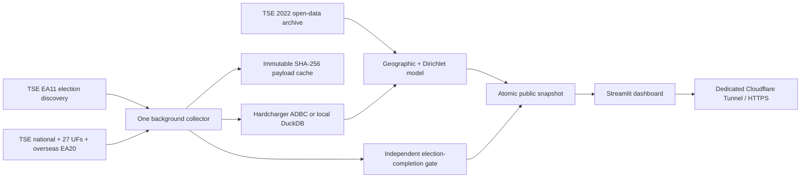

# Brasil 2026 — independent election observatory

**Live dashboard:** https://eleicoes2026.computadorpira.com  
**Public machine-readable state:** https://eleicoes2026.computadorpira.com/api/state  
**Repository:** https://github.com/gustavoleo/eleicao-forecast-2026

Fonte: TSE — Dados Abertos (resultados.tse.jus.br)  
**Projeção estatística, não é resultado oficial.**

This dashboard follows the Brazilian presidential election, automatically discovering the applicable round. It polls the national file every 15 seconds and each of 27 UFs plus overseas (`zz`) every 60 seconds. Model snapshots and browser refreshes occur every 60 seconds. One background collector serves all visitors. Closing a browser does not stop the deployed collector.

The deployed free fallback uses this Windows host's existing Podman WSL2 machine, a persistent named volume, and an isolated Cloudflare Tunnel. **The host and Podman must remain running and connected to the internet.** This is not independently hosted on Streamlit Cloud. Streamlit Cloud was inspected and required sign-in and acceptance of terms. No account or paid service was purchased. Render and Community Cloud deployment instructions are below.

## What “elected” means

Monte Carlo cannot establish mathematical certainty. A model probability, including 5,000 wins in 5,000 draws, never declares somebody elected.

The independent completion gate uses a recent, validated, **official national presidential EA20** and one of:

1. Exactly one candidate marked `e="s"`, together with `md="e"` (TSE's mathematically elected signal) or `tf="s"` (final totalization), and no `esae="s"` (no winner assigned).
2. A conservative arithmetic proof: in round two the leader's counted votes exceed the runner-up's votes plus every potentially remaining vote. In round one, twice the leader's votes exceed all counted valid votes plus that upper bound. Ties do not pass.

The upper bound includes electors in unreported, uncounted and uninstalled sections. Pending judicial/uncounted vote categories disable the independent bound. A mathematical result is explicitly conditional on the current published counts and their remaining-vote bound; later recounts, source corrections and legal decisions are outside that proof. The collector continues checking after a call so corrections remain visible.

**`md="s"` means a runoff is defined; it does not mean someone is elected.** Section completion alone is also insufficient. TSE documents this distinction in [EA20](https://www.tse.jus.br/eleicoes/eleicoes-2026-content/arquivos/divulgacao-de-resultados/tse-ea20-arquivo-de-resultado-unificado).

The UI suppresses confirmation if collection is older than 120 seconds, if an upstream error is active, or if a nonfinal TSE generation is older than five minutes. It separately displays the source generation timestamp, fetch time, and collector heartbeat. Old snapshots remain visible with warnings.

## Architecture



`raw_turbo` and `votes_parcial` append changed payloads only. `votes_projected` and `simulations_meta` retain every model snapshot, seed and input hash. `historical_2022` caches official historical aggregates. The public reader never opens the live DuckDB writer. Historical CSV download selects only the presidential member via HTTP Range, checks its ZIP CRC, records SHA-256 hashes and stores catalog provenance. It avoids downloading the entire approximately 643 MB archive.

## Model and limits

- Above 5% of sections in a UF, the remaining share follows that UF's partial valid-vote share. Otherwise, it uses mapped 2022 UF shares plus the vote-weighted national swing from UFs above 5%.
- Current counted **national** votes are fixed. Remaining volumes use UF electorate coverage and observed valid votes per counted elector; low-count UFs use an explicitly documented 75% valid-vote/eligible-elector assumption. Section percentages are not assumed to be vote percentages.
- Cross-election identities are not silently matched. The live deployment explicitly uses `HISTORICAL_CANDIDATE_MAP={"13":"13","22":"22"}` as a **party/ballot-number proxy**. The 2022 candidate behind number 22 is a different person. The UI labels this assumption. An empty mapping only allows exact full-name matches; missing complete historical correspondence uses a national-share fallback, listed in model assumptions.
- 5,000 Dirichlet draws vary the remaining votes only. Concentration is 20 below 30% counted, 100 from 30% through 80%, and 500 above 80%. These are **requested heuristics, not empirically calibrated probability guarantees**. The 90% intervals are conditional on this model and exclude some geographic/reporting-order/turnout errors.
- The baseline is the current national valid-vote share. Geographic weighting can legitimately produce a different leader. All shares, intervals and simulation seeds are downloadable.
- First-round runoff pair probabilities are joint probabilities of no outright majority and that pair finishing first/second; conditional probabilities are also returned. In round two these and first-round victory probabilities are explicitly not applicable.
- Current implementation models at UF level. It does not yet poll every municipality or section. It supports the national presidential contest only; changing to governor, senator or proportional offices is rejected because their territorial/seat rules differ. These are limitations, not silently completed features.
- The poller does not certify TSE's signatures or electoral legal validity. It consumes the official HTTPS JSON source and retains provenance/hashes.

## Run locally

Python **3.12** is the tested runtime. The exact working package versions are pinned.

```powershell
git clone https://github.com/gustavoleo/eleicao-forecast-2026.git
cd eleicao-forecast-2026
uv venv --python 3.12 .venv
uv pip install --python .venv/Scripts/python.exe -r requirements-dev.txt
Copy-Item .env.example .env
# Set TSE_CONTACT_EMAIL to your real contact email in .env.
.venv/Scripts/python.exe -m src.service
```

Open `http://localhost:8501`; public state is `http://localhost:8080/api/state`. To run a bounded collection: `.venv/Scripts/python.exe -m src.ingest --duration 320`. Do not run two collectors against the same DuckDB file.

## Existing Windows Podman deployment

Use **native `podman.exe`**, connection `podman-machine-default-root`. Never recreate/reset the machine or alter `F:\VMs\WSL\podman-machine-default\ext4.vhdx`.

```powershell
podman.exe --connection podman-machine-default-root ps --filter name=eleicoes2026
podman.exe --connection podman-machine-default-root logs --tail 30 eleicoes2026-dashboard
podman.exe --connection podman-machine-default-root restart eleicoes2026-dashboard
podman.exe --connection podman-machine-default-root restart eleicoes2026-tunnel
Invoke-RestMethod https://eleicoes2026.computadorpira.com/health
```

Resources: `eleicoes2026-dashboard`, `eleicoes2026-tunnel`, `eleicoes2026-net`, named volume `eleicoes2026-data`, and Podman secret `eleicoes2026-tunnel-token`. Only the public dashboard and public JSON/health routes are exposed. Local ports bind to `127.0.0.1:18501` and `127.0.0.1:18502`. No other workloads or firewall policies are changed. A fresh local-only installation can use `scripts/start-podman.ps1` or `podman-compose up -d`; the compose file does not include the account-specific tunnel secret.

Staged update: build a new image with `podman.exe ... build --format docker -t localhost/eleicoes2026:next .`; stop this dashboard only, copy its `/data/eleicoes.duckdb` to a dated backup while stopped, rename its stopped container to a dated rollback name, and start the new image with the same named volume/network/env/port options from `scripts/start-podman.ps1`. Keep the old image/container until the public page and `/api/state` verify. Never delete the named volume. Restart policy handles process failures while Podman is running; it does not power on this host or automatically start a stopped WSL machine.

## Hardcharger

Set `HARDCHARGER_URI`, `HARDCHARGER_USER` and `HARDCHARGER_PASSWORD` in the untracked `.env`, then recreate only the app container using the staged-update procedure (a plain restart does not refresh container environment). `HardchargerSession` bulk ingest uses ADBC; parameterized reads use the Hardcharger ADBC DB-API connection. At startup, absent or unreachable Hardcharger selects local DuckDB and logs the active backend. Existing local data is not automatically migrated to a new server. The deployed fallback is verified; an actual remote Hardcharger server was not supplied, so remote end-to-end storage remains unverified.

## Streamlit Community Cloud deployment

1. Sign in at https://share.streamlit.io and complete any required terms/authorization yourself.
2. Create a public app from `gustavoleo/eleicao-forecast-2026`, branch `main`, entrypoint `src/dashboard.py`; select Python 3.12.
3. Add root-level secrets `TSE_CONTACT_EMAIL="your@email"` and `RUN_EMBEDDED_INGESTOR="1"`; optionally add Hardcharger settings and `HISTORICAL_CANDIDATE_MAP` as a JSON string.
4. Deploy and verify charts, source time and data refresh. This mode starts one process-wide cached collector, but Community Cloud sleep/restarts and ephemeral disk do **not** guarantee uninterrupted collection or retention. The existing Podman deployment is the continuous mode.

## Render / Hugging Face alternatives

Render: sign in at https://dashboard.render.com, choose **New → Blueprint**, connect the repository, select `render.yaml`, set the contact email, and deploy. The Docker service listens on 8501. Free Render instances may sleep and have ephemeral storage; persistence requires external storage or a paid disk (not authorized/purchased here).

Hugging Face: create a **Docker** Space, select port **8501**, copy the repository's Dockerfile/source/requirements, and add the contact email as a Space secret. Streamlit is run inside the Docker SDK. Free Spaces can sleep and have ephemeral disk. No Hugging Face token was available in this environment. These fallback instructions are provided; the working public URL is Cloudflare/Podman.

## Verification

```powershell
postman simulation run postman/simulations/tse.sim.yaml --port 4900 --output ndjson
# In another terminal:
$env:POSTMAN_SIM_URL='http://127.0.0.1:4900/tse'
.venv/Scripts/python.exe -m pytest -q
postman spec lint postman/specs/tse.yaml --issueType=syntax
postman collection lint postman/collections/TSE-Contract
postman collection run postman/collections/TSE-Contract
.venv/Scripts/python.exe scripts/verify_rate.py data/requests.ndjson
```

The mock embeds real TSE fixtures. Owner mock lookup was unavailable without Postman login; Orbit returned unrelated APIs, so the official TSE specification and directly fetched JSON defined the integration. Mocked failure tests exercise the actual HTTP client, including HTML 403/429/500, Retry-After, circuit-breaker suppression, recovery, and conditional 304. Mock success does not certify upstream availability. The local Postman collection run reports two requests and two assertions, zero failures. `evidence/pytest.txt`, `evidence/postman-collection.txt`, `evidence/rate-compliance.json`, and `evidence/deploy-state.json` record distinct evidence.

Five-minute live collection: **318.19 seconds, 191 requests, 161 HTTP 304 responses, peak three response records in a sliding second, mean 0.600 req/s**. This is safely below 90 req/s for this collector; unrelated software on the same IP is outside that log. The scheduler spaces request starts at least 0.5 seconds apart. Response-time clustering can produce three completed responses in one sliding second. See `evidence/live-five-minute-excerpt.txt` for actual heartbeat records.

## Compliance and safety

The live integration follows [TSE's technical documentation](https://www.tse.jus.br/eleicoes/informacoes-tecnicas-sobre-a-divulgacao-de-resultados). EA11 discovery uses `/oficial/comum/config/ele-c.json`; the example `/ele2026/config/ea11.json` returned 404 and is not repeatedly probed. EA20 URLs use discovered election IDs and padded cargo/election fields. The [2022 data catalog](https://dadosabertos.tse.jus.br/dataset/resultados-2022) is the historical source.

Every TSE request identifies the contact via `EleicaoForecast/1.0 (+email)`. A global 2 req/s scheduler is configurable but capped at 10 req/s, below the requested 90 limit. ETags and Last-Modified avoid unchanged downloads; SHA-256 deduplicates when the server still sends a body. A hash alone cannot tell whether remote bytes changed before a request. Changed raw files are retained on disk and in the database.

Errors use exponential backoff from five seconds, capped at 300 seconds plus applicable server Retry-After. HTTP 403 additionally opens a **600-second origin circuit breaker**, following TSE's documented ten-minute block; this deliberately overrides the prompt's generic 300-second cap to avoid extending an IP block. 429/5xx also defer the whole origin. Missing files back off at least five minutes. No aggressive retry loops or fabricated substitute live data.

Secrets live only in `.env`, Podman secrets, or deployment secret stores. `.env`, `data/`, `secrets/` and raw runtime logs are gitignored. Only public TSE fixtures and selected operational evidence are committed. The original reusable request is preserved in `PROMPT.md` and `prompts/PROMPT.md`.

## Status at initial deployment

The source snapshot was generated at **25/10/2026 17:06:31 BRT**, with **0.245369%** of sections counted. The collector could fetch it successfully, but it was already stale. Raw tally: Lula 193,574 (57.6554%), Flavio Bolsonaro 142,169 (42.3446%). With 28 geographical units and the explicitly configured 2022 proxy, the model projected approximately 50.9458% / 49.0542%. The projected leader matches the leader in that source snapshot; this is **not** a verified current winner or a guarantee of eventual results. Completion gate: **undecided**. Monitoring must continue until current official/arithmetic evidence satisfies it.
